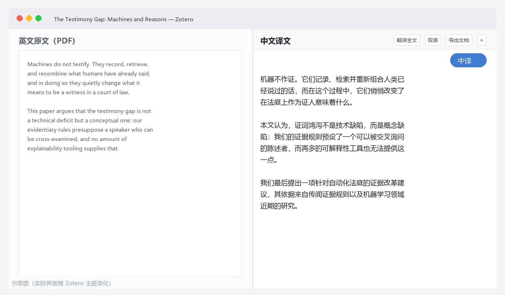
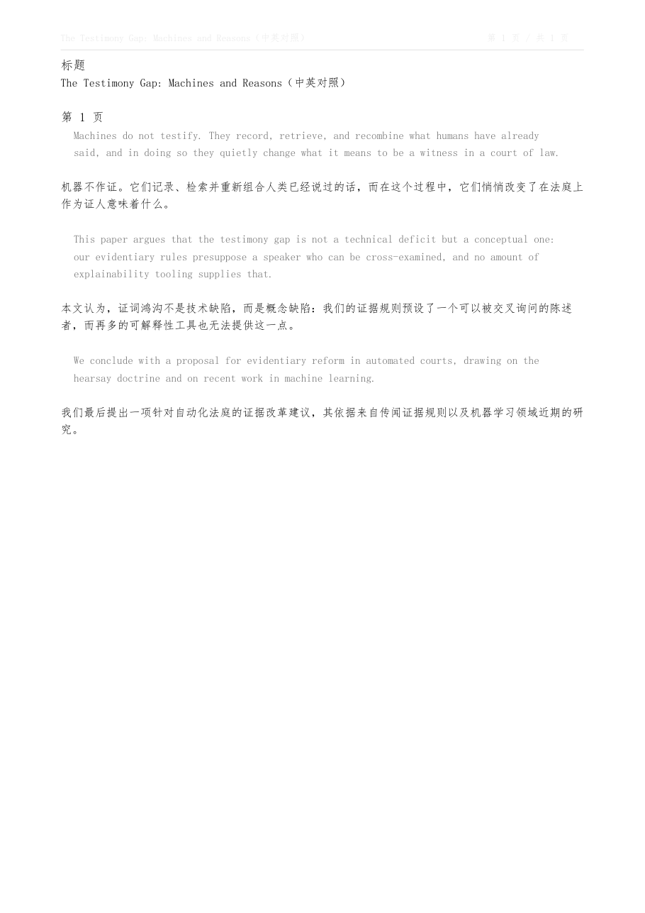

<div align="center">

# 双语论文助手 · Bilingual Paper Reader

**一键把英文论文翻成中文，左英文右中文对照读，还能导出「中文版 + 中英对照版」PDF。**


不需要注册 · 不需要 API Key · **不需要翻墙** · 装上就能用

[安装](#安装) · [使用](#使用) · [翻译引擎](#翻译引擎) · [导出文档](#导出文档) · [常见问题](#常见问题)

</div>

---

## 这个插件是两个人一起做的

| | 做了什么 |
| --- | --- |
| **ChanceZhangcr** | 提需求、真机试用、把每一个问题原样反馈回来（"点按钮没反应""悬浮按钮没了""导出失败""要点好几下才弹出来"），决定做什么、不做什么，最后拍板验收 |
| **DeepSeek**（AI 编程助手） | 写代码、查 Zotero 9 内部实现、调 bug、做字体子集化与 PDF 写出、写测试和这份文档 |

没有第一列那些具体到"点了没反应"的反馈，这个东西做不出来 —— 大部分 bug 都是靠"哪一步没反应"这句话定位的。
第二列负责查证和实现：比如「悬浮按钮一直不显示」的真正原因是漏写了一个函数、异常被 try/catch 吞掉，日志里一个字都没有。


---

## 效果

打开一篇 PDF，阅读器右上角点「中译」，右边就长出一栏中文译文，和左边英文逐段对齐：



翻译完点「导出文档」，条目下会多出两个 PDF。中英对照版长这样 —— 灰色缩进的是英文原文，紧跟下面是这段的中文：

<p align="center">
  
  
</p>

<div align="center"><sub>左：中英对照版（逐段对照） · 右：纯中文版</sub></div>

> 上面两张图是把插件**真实导出**的 PDF 渲染出来的，未经修饰。

## 特性

- **一键整篇翻译** —— 不是选中一段翻一段，是整篇论文一次翻完，边翻边出，可以随时点「停止」
- **左右对照** —— 不动 Zotero 原生的分屏，自己往 `#split-view` 里挂一个译文面板，可拖宽窄；「双语 / 仅译文」随时切换
- **4 个免费引擎** —— 腾讯、有道、MyMemory、Google，全部免密钥；默认腾讯，**国内直连**
- **失败自动降级** —— 一个免费接口抽风，自动换下一个，整篇不会因为一个接口挂掉而失败
- **导出两个版本** —— 「中文译文」和「中英对照」各一个 PDF，挂到该文献条目下（可标注、可搜索）
- **划词翻译** —— 在 PDF 里划选一句话，浮出的工具条上点「译」，就地显示中文
- **按段落缓存** —— 同一篇论文第二次打开不会重复请求接口
- **不写你的库** —— 除了导出时新建的附件，不修改文献、笔记、已有附件

## 安装

**前提：Zotero 9 + Windows 10/11。** 开发和实测都在 **Zotero 9.0.5 / Windows** 上做的，别处没验证过 ——
Zotero 7、8 会直接提示「不兼容」（`strict_min_version` 设成了 9.0）。

**下载地址（二选一）**：

| | 地址 | 说明 |
| --- | --- | --- |
| 主 | [Releases 里的 xpi](../../releases/latest) | 官方 Release 附件 |
| 备用 | [jsDelivr 镜像](https://cdn.jsdelivr.net/gh/ChanceZhangcr/zotero-bilingual-reader@main/releases/bilingual-reader_1.4.2.xpi) | 直连 GitHub 不稳时用这个 |

1. 下载 `bilingual-reader_1.4.2.xpi`
2. Zotero → 菜单 **工具 → 插件**
3. 点插件面板右上角的 **齿轮** → **Install Add-on From File…**（从文件安装插件）
4. 选中那个 `.xpi` → 确认 → **重启 Zotero**

重启后「工具」菜单里出现 **双语对照阅读**，就说明装好了。

<details>
<summary>装不上 / 按钮找不到？</summary>

- Zotero 9 以下不支持，会提示「不兼容」
- 必须重启 Zotero，插件才会加载
- 如果装了多个 Zotero（比如 Beta 版和数据目录分开的），注意装到你在用的那个
</details>

## 使用

| 操作 | 怎么做 |
| --- | --- |
| 整篇翻译 | 打开 PDF → 点阅读器右上角 **「中译」** → 或按 `Ctrl+Alt+T` |
| 只译一段 | 在 PDF 里划选文字 → 浮出的工具条上点「译」 |
| 调栏宽 | 拖动译文栏左边缘的分隔线 |
| 双语 / 仅译文 | 面板上的「双语」按钮 |
| 导出文档 | 面板上的「导出文档」按钮 |
| 关闭对照 | 再按一次 `Ctrl+Alt+T`，或点面板的 `×` |
| 换个位置/设置 | 悬浮按钮可以拖动；**双击复位**；**右键**打开设置 |

也可以从菜单走：`工具 → 双语对照阅读`，或在文献列表里右键一篇论文。

## 翻译引擎

全部**免密钥、免注册**。默认用腾讯，因为它是唯一一个国内直连且不限流的：

| 引擎 | 位置 | 实测耗时 | 说明 |
| --- | --- | --- | --- |
| **腾讯交互翻译** | 国内 | 0.2–0.4 s | **默认**。支持一次 30 段批量，连发 12 次 0 失败 |
| 有道翻译 | 国内 | 0.1 s | 短句最快；长文（>800 字符）返回空，且限流很严 |
| MyMemory | 国外 | 1–3 s | 免费兜底，匿名每天约 1000 词 |
| Google 翻译 | 国外 | 首次 30 s+ | 国内裸连很慢，建议挂代理 |

> 数据是本机（国内家宽）实测，2026-10。

想更好的学术翻译质量，可以在设置里换成 **DeepSeek** 或任意 **OpenAI 兼容端点**（填自己的 API Key，一篇 16 页论文约几分钱）；本地跑 **Ollama** 也可以，Base URL 填 `http://127.0.0.1:11434/v1`，完全离线不花钱。

设置里还有个「测试当前引擎」按钮，改完可以点一下确认通不通。

## 导出文档

默认一次生成**两个** PDF，都挂到该文献条目下面：

- `《论文标题》（中文译文）.pdf` —— 纯中文
- `《论文标题》（中英对照）.pdf` —— 英文原文（灰色、缩进）+ 中文译文，逐段对照

在 **编辑 → 设置 → 双语论文助手 → 导出文档** 里可以改成「只要中文版」或「只要中英对照版」。

字体用的是 Windows 自带中文字体（仿宋/黑体/等线，兜底微软雅黑、宋体），**只嵌入用到的字形**，10 MB 的字体最后只进去几百 KB。TTF 和 TTC（字体集合）都支持。

排版上做了两件容易忽略的事：英文按**单词**边界折行（不会出现 `explain` / `ability` 被劈开），中文避头尾（不会让「，」跑到行首）。

## 常见问题

<details>
<summary><b>右上角没有「中译」按钮</b></summary>

确认插件在「工具 → 插件」里是启用状态，然后重启 Zotero。按钮只在**打开 PDF 时**出现，且只出现在阅读器窗口里。
</details>

<details>
<summary><b>点了没反应 / 一直显示「正在提取全文」</b></summary>

长论文提取文字要几秒。超过 30 秒没动静就看日志（见下）。
</details>

<details>
<summary><b>翻译出来是空的 / 报错</b></summary>

先换个引擎试试（腾讯 → 有道 → DeepSeek）。免费接口是各家网页版在用的公开端点，被限流是常事。
</details>

<details>
<summary><b>导出的 PDF 里中文是空白</b></summary>

系统里没找到可用中文字体。会弹错误提示说明试过哪些路径。装个中文字体，或把日志发我。
</details>

<details>
<summary><b>出问题了怎么反馈</b></summary>

发这个文件就够了：

```
C:\Users\<用户名>\Zotero\bilingual-reader\diagnostic.log
```

里面按时间记了每一步做到哪、失败在哪一步、原始错误是什么。
</details>

## 已知限制

诚实写在这里，免得白折腾：

- **只支持 Zotero 9 + Windows**。Zotero 7/8 装不上（版本号卡住）；macOS / Linux **没测过** —— 代码里留了兜底，不保证能用
- 免费翻译接口是各家网页版的**公开端点，不是正式 API**，被限流、改协议都很正常；量大了会不稳
- PDF 导出是**自己画的**（没有用 Zotero 自带的转换），所以排版比较朴素：A4、单栏、页眉带标题和页码，不做原版式的图文重排
- 译文按段落对照，**不保留原文的字体、图、表格**
- 划词翻译只给一句话的中文，不保留上下文

## 隐私

- 只把**段落文本**发给翻译服务，不发 PDF 文件本身
- 用哪个引擎由你决定，请求直接发往该引擎，不经过任何中转服务器
- 译文缓存在本地 `<Zotero 数据目录>/bilingual-reader/`，不上传
- 除导出时新建一个附件，不修改文献库里的任何东西

## 开发

```bash
node build.mjs                 # 合并 src/*.js → build/bilingual-reader_x.y.z.xpi
node install.mjs --force       # 装进本机 Zotero（要先退出 Zotero）
node install.mjs --unpacked    # 以解压目录形式安装，方便改完直接重启看效果
```

### 测试

```bash
node selftest.mjs                     # 静态 + 沙箱内断言（240+ 项）
node test-prefs.mjs                   # 设置面板
node tools/test-sandbox-tools.mjs     # TTF 子集化 / PDF 写出
node tools/test-deflate.mjs           # 自研 DEFLATE
node tools/test-pdf.mjs               # PDF 结构
node tools/test-export-attach.mjs     # 导出挂附件（父条目 / 两个版本）
node tools/test-ttc.mjs               # TTC 字体集合
node tools/test-engines-live.mjs      # 真实端点（需要联网）
node tools/check-refs.mjs             # 找"调用了但没定义"的函数
```

### 目录结构

```
src/
  manifest.json       插件清单（Zotero 要求 applications.zotero 三个字段齐全）
  bootstrap.js        生命周期入口
  00-core.js          命名空间 / pref / 分段 / 日志 / AbortController 垫片
  01-ttf.js           TrueType 解析 + 字体子集化（含 TTC）
  02-pdf.js           PDF 写出（CIDFontType2 + Identity-H + ToUnicode）
  03-deflate.js       纯 JS DEFLATE（Zotero 沙箱里没有 CompressionStream）
  10-translate.js     4 个免费引擎 + LLM 引擎
  20-cache.js         按段落缓存
  30-paper.js         PDF 全文提取 → 分段 → 逐块翻译
  40-reader.js        左侧 PDF / 右侧译文的分栏面板
  50-selection.js     划词浮窗
  60-main.js          悬浮按钮、菜单、快捷键、看护循环
  70-export.js        导出 PDF/HTML 并挂为附件
  99-main.js          自检
build.mjs             构建脚本（语法检查 → 引用检查 → 打 zip）
```

### 发布新版本

一条命令（需要先 `gh auth login` 过一次）：

```bash
node tools/publish-github.mjs
```

它会：填好 `update_url` → 构建 xpi → 提交 → 推送 → 发 Release → 更新 jsDelivr 镜像。
手动做的话是这几步：

1. 改 `src/manifest.json` 的 `version`
2. `node build.mjs` → 得到 `build/bilingual-reader_x.y.z.xpi`
3. 在 GitHub 建一个 Release，tag 用 `vx.y.z`，把 `.xpi` 传上去
4. 把 xpi 再复制到 `releases/` 目录（jsDelivr 镜像走这里）
5. 更新根目录 `update.json` 里的 `version` 和 `update_link`

> ⚠️ `update_url` **不要**用 `raw.githubusercontent.com` —— 这个域名在国内 DNS 解析失败（实测），
> 用了之后老用户永远收不到更新提示，而且不会报错。现在用的是 jsDelivr。

## 许可

[MIT](LICENSE) · 版权归 **ChanceZhangcr**，代码由 **ChanceZhangcr 与 DeepSeek** 共同完成

## 免责声明

插件里用到的免费翻译端点（腾讯 / 有道 / MyMemory / Google）都是各家面向网页版的公开接口，**不是给第三方调用的正式 API**，随时可能限流、改协议或失效。日常读几十篇没问题；如果要长期稳定的批量翻译，建议用 DeepSeek 等付费接口或本地 Ollama。

本插件与 Zotero 官方无关。
